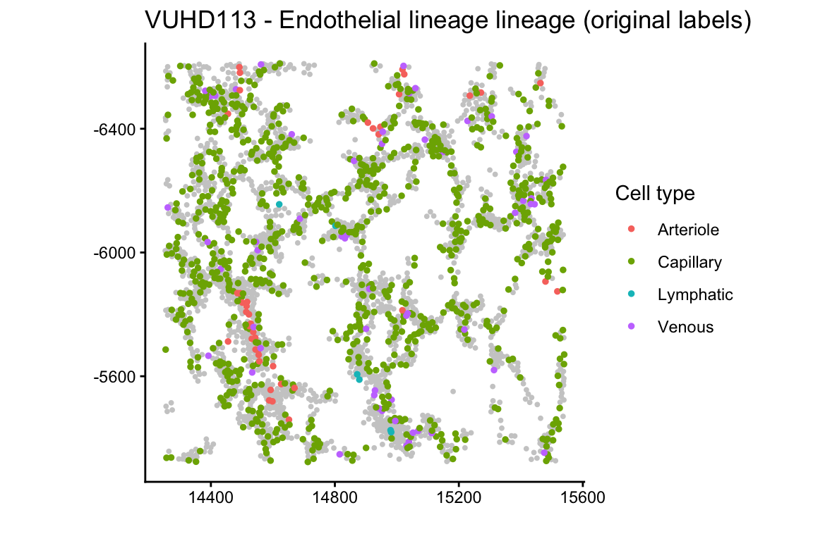
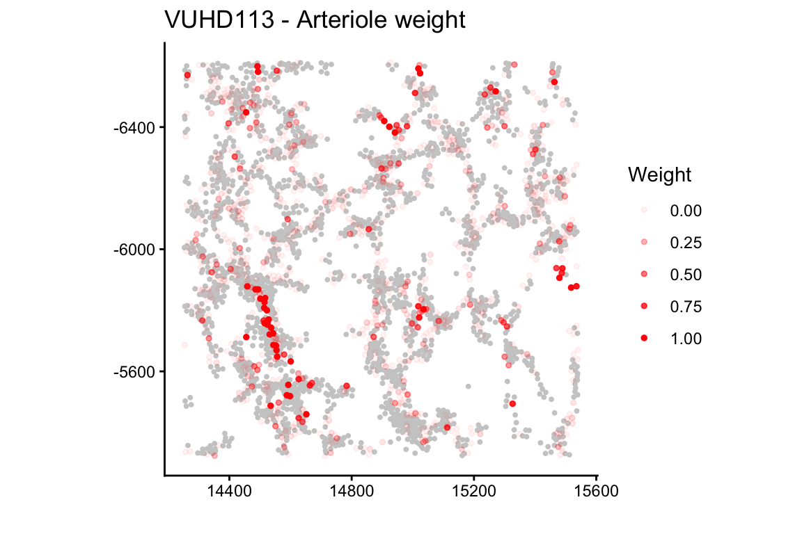
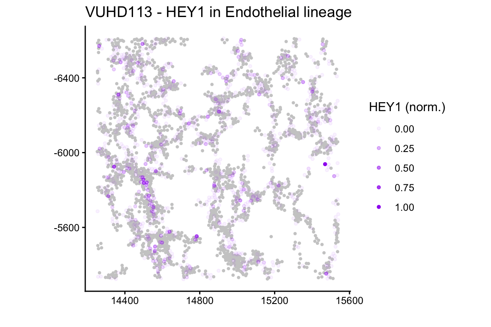
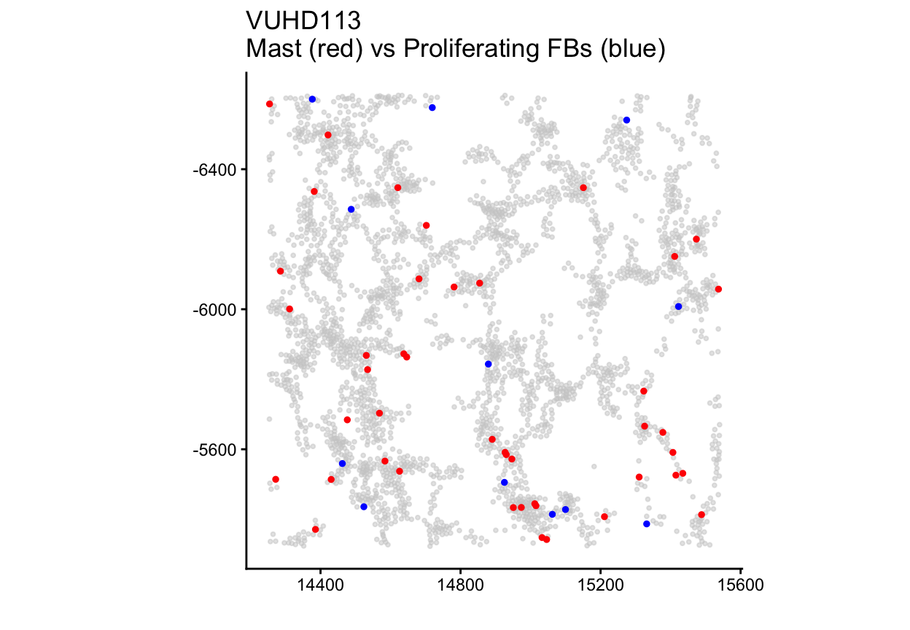
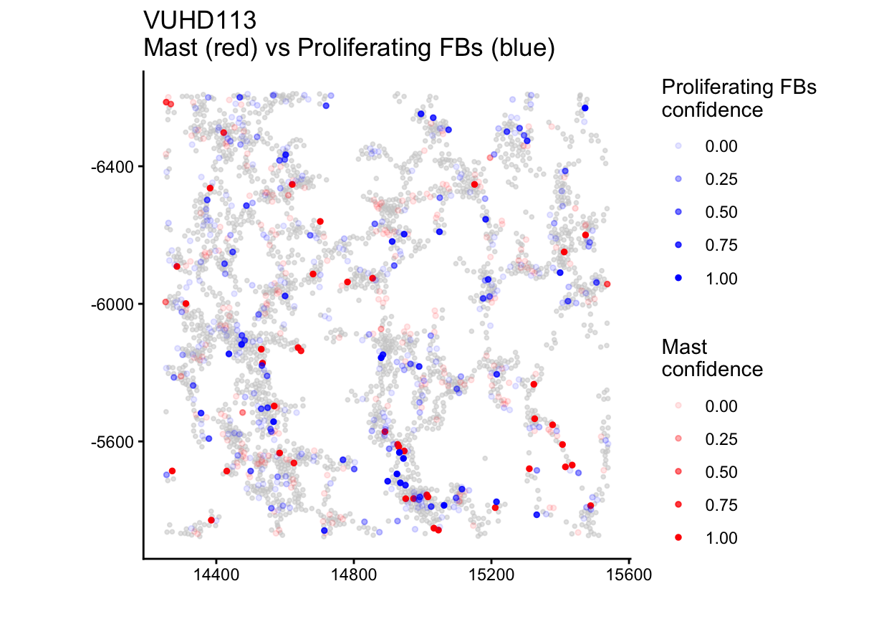
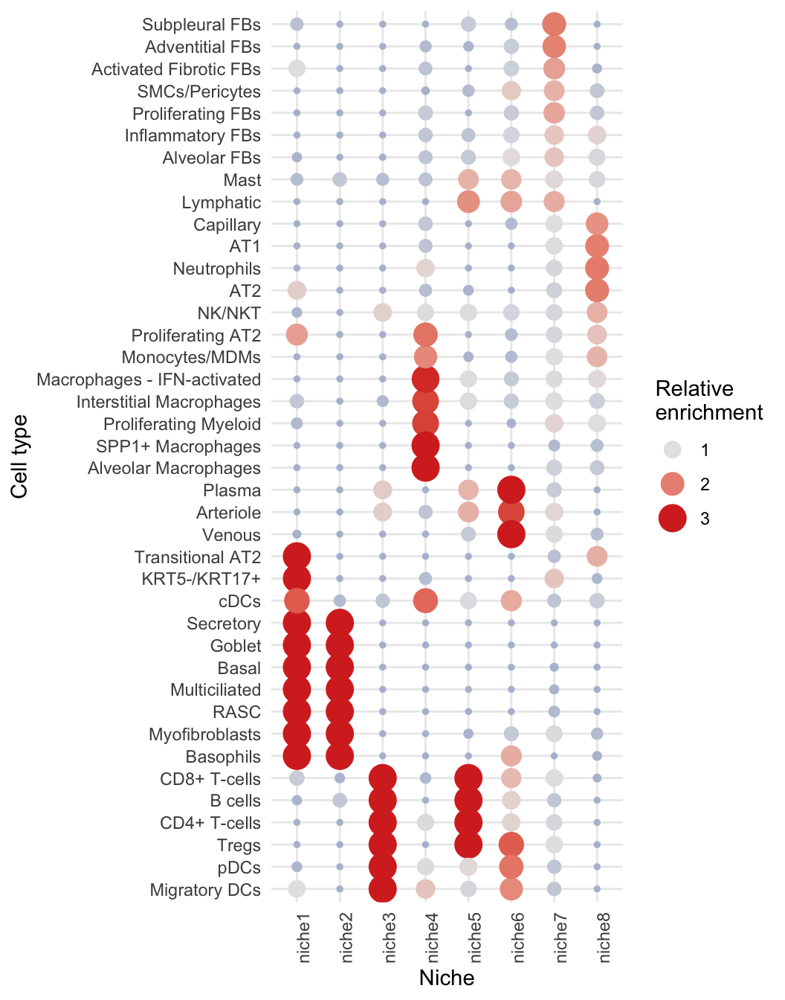
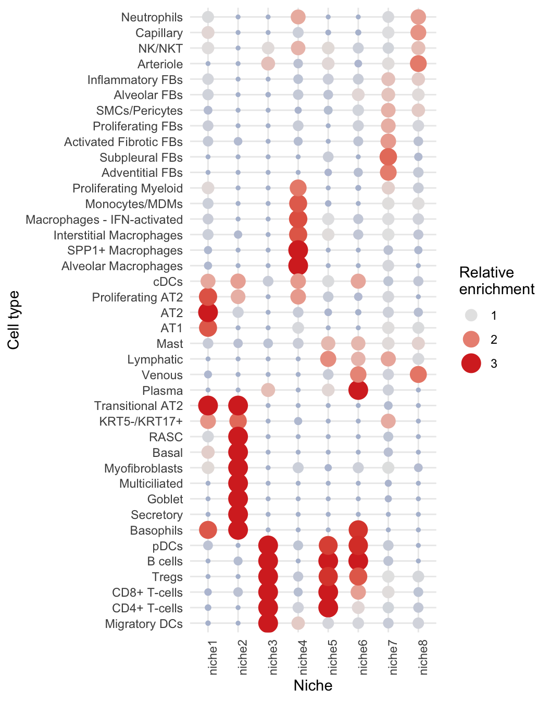
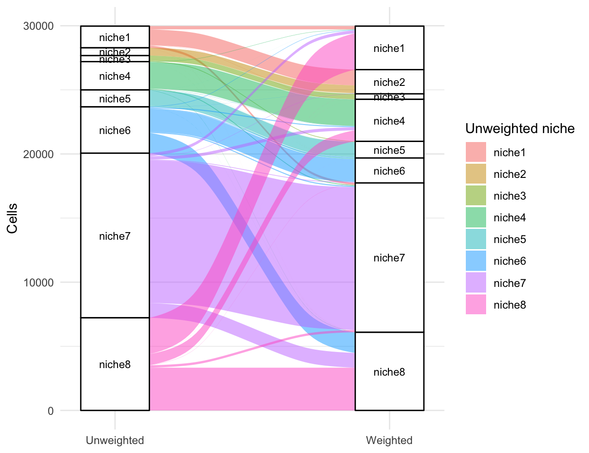
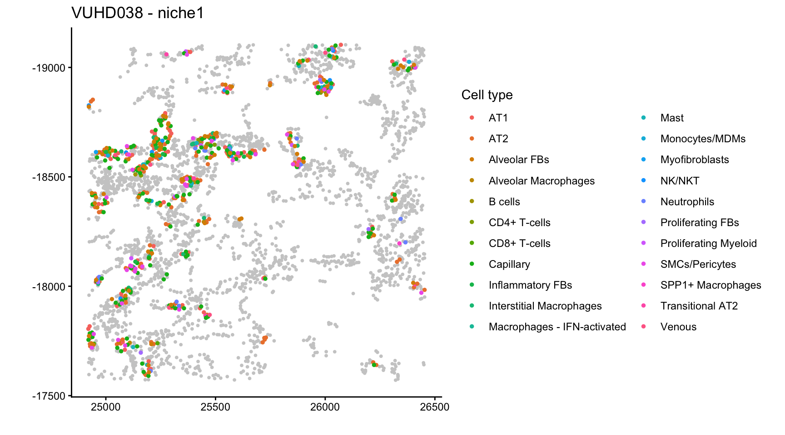

# Confidence-weighted spatial analysis with fuzzyCell

## 1 Overview

Cell type annotation in spatial transcriptomics data is subject to
considerable uncertainty. Transcript diffusion and imperfect
segmentation assign transcripts to neighbouring cells, and limited gene
panels yield sparse expression profiles, so closely related subtypes
such as CD4+ and CD8+ T cells are frequently misclassified. Downstream
analyses nonetheless typically treat annotations as fixed, and this
uncertainty propagates, unaccounted for, into estimates of cell type
proportions, co-localisation and niche composition.

*fuzzyCell* quantifies this uncertainty by bootstrapping. Within each
group of closely related subtypes, a classifier is trained on the
original annotations, and each cell is repeatedly reclassified after
multinomial resampling of its transcript counts. The proportion of
resamples in which a cell is assigned to a subtype defines its
**confidence** in that subtype. These confidences serve as **soft cell
type weights**: each cell contributes to every subtype of its group in
proportion to its confidence, rather than to a single label. Each
analysis can be performed with the original annotations (*unweighted*)
and with the confidence weights (*weighted*), and comparing the two
identifies conclusions that are sensitive to annotation uncertainty.

| If you want to know… | Use | Built on |
|:---|:---|:---|
| whether a cell type’s proportion differs between outcomes | [`runProportionsPipeline()`](https://shreyarajeshrao.github.io/fuzzyCell/reference/runProportionsPipeline.md), [`runProportionsRelativeToParentPipeline()`](https://shreyarajeshrao.github.io/fuzzyCell/reference/runProportionsPipeline.md) | linear models of image-level proportions |
| whether two cell types co-localise more or less between outcomes | [`runColocalisationModels()`](https://shreyarajeshrao.github.io/fuzzyCell/reference/runColocalisationModels.md) | [spicyR](https://bioconductor.org/packages/spicyR)’s L-function, and Statial’s Kontextual test for relative co-localisation |
| whether tissue neighbourhoods (niches) differ between outcomes | [`runNicheIdentification()`](https://shreyarajeshrao.github.io/fuzzyCell/reference/nicheIdentification.md), [`testNicheOutcome()`](https://shreyarajeshrao.github.io/fuzzyCell/reference/testNicheOutcome.md) | [lisaClust](https://bioconductor.org/packages/lisaClust) |

The rest of this vignette follows the workflow on a real dataset.

## 2 Installation

``` r

if (!requireNamespace("BiocManager", quietly = TRUE)) {
    install.packages("BiocManager")
}
BiocManager::install("fuzzyCell")
```

## 3 Example data: lung biopsies

We follow the whole workflow on Xenium lung biopsies from patients with
pulmonary fibrosis and from controls (Vannan et al., 2025). The full
data are available as `SpatialDatasets::spe_Vannan_2025()`. The package
includes a small subset, `lungSubset`: five control and five disease
biopsies, each cropped to a window of about 3,000 cells at its centre.
Every image comes from a different patient, and `disease_status` records
whether the patient is a control or has pulmonary fibrosis.

``` r

library(fuzzyCell)
library(SpatialExperiment)
library(ggplot2)

data(lungSubset)
spe = lungSubset
spe
#> class: SpatialExperiment 
#> dim: 343 29971 
#> metadata(0):
#> assays(1): counts
#> rownames(343): ABCC2 ACKR1 ... YAP1 ZEB1
#> rowData names(0):
#> colnames(29971): TILD167LA_aiflfbgd-1 TILD167LA_aifmhkpg-1 ...
#>   VUILD105MA2_aaaafoki-1 VUILD105MA2_aaaafokj-1
#> colData names(6): cellID imageID ... disease_status sample_id
#> reducedDimNames(0):
#> mainExpName: NULL
#> altExpNames(0):
#> spatialCoords names(2) : x y
#> imgData names(0):

# one image (and one outcome) per patient
imageOutcome = unique(colData(spe)[, c("imageID", "disease_status")])
table(imageOutcome$disease_status)
#> 
#> Control Disease 
#>       5       5
```

> **Note**
>
> Any `SummarizedExperiment` (such as a `SpatialExperiment`) works as
> long as it has a `"counts"` assay and the cell metadata columns
> `cellID`, `imageID`, `cellType`, `x` and `y` in its `colData`. If your
> columns are named differently, the analysis functions take arguments
> (such as `cellType` and `imageID`) giving the column names.

## 4 The cell type tree

Confidence scores are estimated only between closely related cell types,
so *fuzzyCell* requires a hierarchy specifying which subtypes may be
confused with one another. The hierarchy is supplied as a nested list. A
group of subtypes to be refined together is specified as
`list(children = ...)`; every other entry is either an organisational
level (such as the lineage `"Immune"`) or a leaf cell type that is not
refined (such as `"SMCs/Pericytes"`). Each top-level entry must be
named. The cell type tree for the lung data is defined as follows:

``` r

tree = list(
    "Immune" = list(
        "Myeloid" = list(
            "Macrophage lineage" = list(children = c("Alveolar Macrophages",
                "Interstitial Macrophages", "SPP1+ Macrophages",
                "Macrophages - IFN-activated", "Monocytes/MDMs")),
            "Dendritic cells" = list(children = c("cDCs", "Migratory DCs",
                "Langerhans cells", "pDCs")),
            "Granulocytes" = list(children = c("Mast", "Basophils", "Neutrophils")),
            "Proliferating Myeloid"),
        "Lymphoid" = list(
            "T cells" = list(children = c("CD4+ T-cells", "CD8+ T-cells", "Tregs",
                "Proliferating T-cells")),
            "NK lineage" = list(children = c("NK/NKT", "Proliferating NK/NKT")),
            "B lineage" = list(children = c("B cells", "Plasma",
                "Proliferating B cells")))),
    "Mesenchymal" = list(
        "Fibroblast lineage" = list(children = c("Alveolar FBs", "Adventitial FBs",
            "Activated Fibrotic FBs", "Inflammatory FBs", "Subpleural FBs",
            "Proliferating FBs", "Myofibroblasts")),
        "SMCs/Pericytes",
        "Mesothelial"),
    "Endothelial lineage" = list(children = c("Arteriole", "Venous", "Capillary",
        "Lymphatic")),
    "Epithelial lineage" = list(
        "Alveolar" = list(children = c("AT1", "AT2", "Transitional AT2",
            "Proliferating AT2")),
        "Airway" = list(children = c("Basal", "Secretory", "Goblet", "Multiciliated",
            "RASC", "PNEC", "KRT5-/KRT17+", "Proliferating Airway"))))
buildCellTypeMap(tree)$groupsWithChildren
#>  [1] "Macrophage lineage"  "Dendritic cells"     "Granulocytes"       
#>  [4] "T cells"             "NK lineage"          "B lineage"          
#>  [7] "Fibroblast lineage"  "Endothelial lineage" "Alveolar"           
#> [10] "Airway"
```

The same tree is included in the package and can be loaded with
`data(lungCellTypeTree)`. Each of the groups listed above can receive
confidence scores. Cell types outside a group, such as `SMCs/Pericytes`
and `Mesothelial`, are not refined and retain their original labels.

## 5 Bootstrap confidence

[`bootstrapLineageConfidence()`](https://shreyarajeshrao.github.io/fuzzyCell/reference/bootstrapLineageConfidence.md)
does the work, group by group, as described in the Overview. Within each
group it uses ridge multinomial logistic regression on the first 50
principal components of the group’s cells (`classifier = "pcaLogistic"`,
the default, and what we use here). `"logistic"` fits it on all genes.
Other available classifiers include random forest (`"rf"`), linear
discriminant analysis (`"lda"`) and support vector machines (`"svm"`).

The classifier is trained with the same number of cells of each subtype,
which gives every subtype the same prior. `priors = "observed"` instead
weights each subtype by its share of the group’s cells.

We use 20 resamples to keep the vignette quick, but we encourage at
least 100 for your own analysis.

``` r

confList = bootstrapLineageConfidence(spe, tree, nBoot = 20, classifier = "pcaLogistic",
    seed = 1)
```

The result, `confList`, is a list with one data frame per group. Each
data frame has one row per cell in the group, a `cellID` column, and one
column per subtype holding that cell’s confidence in it (between 0 and
1, adding up to 1 across the subtypes):

``` r

names(confList)
#> [1] "Macrophage lineage"  "Dendritic cells"     "Granulocytes"       
#> [4] "T cells"             "B lineage"           "Fibroblast lineage" 
#> [7] "Endothelial lineage" "Alveolar"            "Airway"
head(confList[["Endothelial lineage"]])
#>               cellID Capillary Venous Lymphatic Arteriole
#> 1 VUHD090_afkejaeg-1      0.60   0.00      0.40      0.00
#> 2 VUHD090_afkgbjaj-1      1.00   0.00      0.00      0.00
#> 3 VUHD090_afkgcoce-1      0.90   0.10      0.00      0.00
#> 4 VUHD090_aflfekgk-1      0.95   0.00      0.00      0.05
#> 5 VUHD090_aflfgcca-1      0.85   0.15      0.00      0.00
#> 6 VUHD090_aflfkdoo-1      0.70   0.00      0.05      0.25
```

How spread out are the confidences? Here are the scores for the subtypes
of two groups, the B lineage and the endothelial cells.

``` r

groups = c("B lineage", "Endothelial lineage")
scores = do.call(rbind, lapply(groups, function(g) {
    conf = confList[[g]]
    do.call(rbind, lapply(setdiff(names(conf), "cellID"), function(subtype)
        data.frame(panel = paste0(g, ": ", subtype), confidence = conf[[subtype]])))
}))
ggplot(scores, aes(confidence)) +
    geom_histogram(bins = 20, fill = "#4c78a8", colour = "white") +
    facet_wrap(~panel, ncol = 2, scales = "free_y") +
    labs(x = "confidence in the subtype", y = "number of cells") +
    theme_classic()
```


In the B lineage every cell scores close to 0 or 1 for each subtype, so
the classifier is sure which one it is. The endothelial cells are
different: many capillary cells, and some venous cells, have scores
spread between 0 and 1, so they are split between subtypes. Few cells
score close to 1 for arterioles, but many get a small arteriole score.
Cells with scores in the middle count partly towards each subtype in the
weighted analyses, which is where weighted and unweighted results can
differ.

## 6 Cell type proportions

Does the proportion of each cell type differ between controls and
patients with pulmonary fibrosis?
[`runProportionsPipeline()`](https://shreyarajeshrao.github.io/fuzzyCell/reference/runProportionsPipeline.md)
fits, for each cell type, a linear model of its per-image proportion on
the outcome, once with the confidences as soft counts (weighted) and
once with the original labels (unweighted).

It takes as input the `SpatialExperiment` (`spe`), the cell type tree
and the confidence list (`confList`). The outcome of interest is given
by `outcomeCol`, the name of a column of `colData(spe)` with exactly two
levels and a single value per image. `subject` is the name of the
`colData(spe)` column identifying the patient each image comes from:
every image must belong to a single subject, and every subject must
contribute only one image.

In the results, `estimate` is the difference in proportion for the
second level of the outcome relative to the first (alphabetical order
for text, factor order for factors); here that is `Disease` minus
`Control`. `p.adj` is the Benjamini-Hochberg adjusted p-value across the
cell types tested.

``` r

props = runProportionsPipeline(spe, tree, confList,
    outcomeCol = "disease_status", subject = "subject")
```

``` r

head(props$modelWeighted)
#>                      cellType      estimate   statistic      p.value
#> 1           SPP1+ Macrophages -1.310508e-02 -0.77121245 0.4627488770
#> 2    Interstitial Macrophages  3.940842e-02  1.21029437 0.2607089576
#> 3              Monocytes/MDMs -4.222446e-02 -3.99016928 0.0040043674
#> 4 Macrophages - IFN-activated -4.393489e-05 -0.01618578 0.9874825679
#> 5        Alveolar Macrophages -1.883044e-02 -2.55869696 0.0337152591
#> 6                        pDCs  2.360524e-03  5.18432305 0.0008383089
#>         p.adj            lineage
#> 1 0.548469011 Macrophage lineage
#> 2 0.360990284 Macrophage lineage
#> 3 0.021529968 Macrophage lineage
#> 4 0.987482568 Macrophage lineage
#> 5 0.075093077 Macrophage lineage
#> 6 0.008215428    Dendritic cells
head(props$modelUnweighted)
#>                 cellType     estimate statistic      p.value       p.adj
#> 1                    AT1 -0.056423088 -6.019916 0.0003163026 0.005166276
#> 2                    AT2 -0.062000588 -2.672547 0.0282504775 0.085207194
#> 3 Activated Fibrotic FBs  0.032368686  1.698599 0.1278236699 0.202043865
#> 4        Adventitial FBs  0.002671612  1.702293 0.1271109437 0.202043865
#> 5           Alveolar FBs  0.033136972  1.821128 0.1060687672 0.192495170
#> 6   Alveolar Macrophages -0.017538426 -2.664393 0.0286099163 0.085207194
```

For most cell types the weighted and unweighted analyses agree.
Arterioles are one where they do not: with the original labels their
proportion does not differ clearly between the outcomes, but with the
confidences it is lower in disease.

``` r

cols = c("cellType", "estimate", "p.value", "p.adj")
rbind(
    unweighted = subset(props$modelUnweighted, cellType == "Arteriole")[, cols],
    weighted = subset(props$modelWeighted, cellType == "Arteriole")[, cols])
#>             cellType     estimate      p.value       p.adj
#> unweighted Arteriole -0.003999019 0.1218105531 0.202043865
#> weighted   Arteriole -0.020240935 0.0002203022 0.002698701
```

We can use
[`plotProportionBoxplot()`](https://shreyarajeshrao.github.io/fuzzyCell/reference/plotProportionBoxplot.md)
to visualise the per-patient proportions behind a cell type’s estimate.

``` r

plotProportionBoxplot(props, "Arteriole", spe, "disease_status")
```

The plot is interactive: hovering over a point tells you which sample it
is, so you can find the patients behind an estimate. As an example,
let’s look more closely at one image, the control biopsy `VUHD113`.

[`plotOriginalLabelSpatial()`](https://shreyarajeshrao.github.io/fuzzyCell/reference/plotSpatial.md)
shows the endothelial cells of the image with their hard labels, and
[`plotWeightedSpatial()`](https://shreyarajeshrao.github.io/fuzzyCell/reference/plotSpatial.md)
shows the same cells coloured by their confidence of being arterioles.

``` r

# the endothelial lineage with its original labels
plotOriginalLabelSpatial(spe, tree, "VUHD113", "Endothelial lineage")
```



``` r


# the same cells, weighted by their confidence of being arterioles
plotWeightedSpatial(spe, tree, confList, "VUHD113", "Endothelial lineage", "Arteriole")
```



Marker expression helps to judge whether the confidences are sensible.
Here is the arterial marker `HEY1` in the endothelial cells of this
image:

``` r

plotOneMarkerSpatial(spe, "VUHD113", "Endothelial lineage", "HEY1", cellTypeTree = tree)
```



HEY1 expression is concentrated in the same vessels as the cells with
high arteriole confidence, and is largely absent from the rest of the
endothelium. In this image HEY1 is detected in 80% of the cells labelled
as arterioles and in 16% of the other endothelial cells. It is detected
in 65% of the cells with an arteriole confidence of at least 0.5,
compared with 9% of the cells with none, so the confidences are
consistent with the marker.

### 6.1 Proportions relative to the parent group

The proportion of a subtype among all cells can change simply because
its whole group changes.
[`runProportionsRelativeToParentPipeline()`](https://shreyarajeshrao.github.io/fuzzyCell/reference/runProportionsPipeline.md)
instead models each subtype as a proportion of its group (for example,
AT2 cells among all alveolar epithelial cells). It takes the same inputs
as
[`runProportionsPipeline()`](https://shreyarajeshrao.github.io/fuzzyCell/reference/runProportionsPipeline.md)
and returns weighted and unweighted models in the same format:

``` r

relProps = runProportionsRelativeToParentPipeline(spe, tree, confList,
    outcomeCol = "disease_status", subject = "subject")
```

## 7 Co-localisation

[`runColocalisationModels()`](https://shreyarajeshrao.github.io/fuzzyCell/reference/runColocalisationModels.md)
tests, for every pair of cell types and groups, whether their spatial
co-localisation differs between the two outcomes.

For an ordered pair `from` → `to`, co-localisation in each image is
quantified by the cross-type L-function, computed by spicyR at a radius
`r` (50 by default, in the units of the spatial coordinates). Positive
values indicate that more `to` cells lie within `r` of `from` cells than
expected if the cells were placed at random (attraction), negative
values indicate fewer than expected (avoidance), and values near 0
indicate neither. For each pair, the per-image values are then modelled
against the outcome with a linear model, once with the original
annotations (unweighted) and once with the confidence weights
(weighted). In the weighted analysis, each cell contributes to a label
in proportion to its confidence. *Relative* co-localisation, which
compares a pair with the parent population of the `to` cell type, is
assessed with Statial’s Kontextual test using the same weights.

The confidence weights themselves are returned by
[`confidenceWeights()`](https://shreyarajeshrao.github.io/fuzzyCell/reference/confidenceWeights.md)
as a matrix with one column per cell type and group, and can be passed
directly to spicyR and lisaClust through their `cellWeights` argument.

``` r

coloc = runColocalisationModels(spe, tree, confList,
    outcomeCol = "disease_status", subject = "subject", r = 50)
```

The weighted and unweighted results are returned together. Mast cells
and proliferating fibroblasts are a pair where they disagree: with the
original labels their co-localisation does not differ significantly
between the outcomes, while with the confidences it is lower in disease.

``` r

subset(coloc$modelUnweighted, from == "Mast" & to == "Proliferating FBs")
#>      from                to estimate       se statistic   p.value     p.adj
#> 2086 Mast Proliferating FBs 10.93041 14.62322 0.7474692 0.4761743 0.7674124
subset(coloc$modelWeighted, from == "Mast" & to == "Proliferating FBs")
#>      from                to  estimate       se statistic   p.value     p.adj
#> 2086 Mast Proliferating FBs -10.73341 3.739982  -2.86991 0.0208318 0.2231241
```

[`plotMetricBoxplot()`](https://shreyarajeshrao.github.io/fuzzyCell/reference/plotMetricBoxplot.md)
shows the per-image values behind the pair:

``` r

plotMetricBoxplot(coloc, spe, "Mast", "Proliferating FBs",
    "disease_status", metric = "lfunction")
```

The difference is largely driven by the `Control` samples showing
increased attraction after weighting. We can take a closer look at one
such sample, `VUHD113`:

``` r

# the two cell types with their original labels
plotHardSpatialPair(spe, "VUHD113", "Mast", "Proliferating FBs", tree)
```



``` r


# the same two cell types, weighted by their confidences
plotWeightedSpatialPair(spe, tree, confList, "VUHD113", "Granulocytes", "Mast",
    "Fibroblast lineage", "Proliferating FBs")
```



With the original labels, the image contains only 12 proliferating
fibroblasts, none of which lie within 50 µm of any of its 44 mast cells,
so the L-function for the pair is at its minimum. With the confidences,
proliferating-fibroblast weight (blue) is spread across 190
fibroblast-lineage cells. Of the 59 cells with a confidence of at least
0.5, 51 are labelled as alveolar fibroblasts, and 54 of the weighted
cells lie within 50 µm of a mast cell, which produces the apparent
attraction. The mast cells (red) keep high confidences after weighting,
so the change comes almost entirely from the fibroblasts.

## 8 Niches

Niches are recurring local neighbourhoods: groups of cells that share a
similar mix of surrounding cell types.
[`runNicheIdentification()`](https://shreyarajeshrao.github.io/fuzzyCell/reference/nicheIdentification.md)
describes every cell by its local indicators of spatial association from
lisaClust, at several radii, and clusters those profiles into `k`
niches. It does this twice, with the hard labels and with the weights,
in which each neighbour counts towards a cell type in proportion to its
confidence.

``` r

niches = runNicheIdentification(spe, tree, confList, r = c(20, 50), k = 8)
```

The niche plots take the niche assignments returned by
[`runNicheIdentification()`](https://shreyarajeshrao.github.io/fuzzyCell/reference/nicheIdentification.md).
[`nicheCompositionMap()`](https://shreyarajeshrao.github.io/fuzzyCell/reference/nichePlots.md)
shows which cell types are enriched in each niche, here for the
unweighted (left) and weighted (right) niches:

``` r

nicheCompositionMap(spe, niches$nicheUnweighted)
nicheCompositionMap(spe, niches$nicheWeighted)
```





Most niches have similar compositions with and without weights. The main
exception is the alveolar niche (`niche8`): without weights it combines
AT1 and AT2 cells with capillaries and neutrophils, whereas with weights
it is split into an epithelial niche of AT2, transitional AT2 and AT1
cells (`niche1`) and a vascular niche of venous, arteriole and capillary
cells (`niche8`).

An alluvial plot, drawn here with the ggalluvial package, shows how
cells move between the unweighted and weighted niches:

``` r

library(ggalluvial)
flows = as.data.frame(table(unweighted = niches$nicheUnweighted,
    weighted = niches$nicheWeighted), responseName = "cells")
ggplot(flows, aes(axis1 = unweighted, axis2 = weighted, y = cells)) +
    geom_alluvium(aes(fill = unweighted), width = 1/4) +
    geom_stratum(width = 1/4) +
    geom_text(stat = "stratum", aes(label = after_stat(stratum)), size = 3) +
    scale_x_discrete(limits = c("Unweighted", "Weighted"), expand = c(0.1, 0.1)) +
    labs(y = "Cells", fill = "Unweighted niche") +
    theme_minimal()
```



The split of the alveolar niche is visible as flows of cells: the
unweighted `niche8` divides between the weighted `niche8` (46%),
`niche1` (39%) and `niche4` (12%).

[`plotNicheSpatial()`](https://shreyarajeshrao.github.io/fuzzyCell/reference/nichePlots.md)
shows where a niche’s cells are in an image:

``` r

plotNicheSpatial(spe, "VUHD038", "niche1", nicheCol = niches$nicheWeighted)
```



The proportion of each niche can be tested against the outcome in the
same way as the cell types:

``` r

nicheTests = testNicheOutcome(spe, niches$nicheUnweighted,
    niches$nicheWeighted, outcomeCol = "disease_status", subject = "subject")
nicheTests$testWeighted
#>    niche    estimate statistic    p.value     p.adj
#> 1 niche8 -0.12617351        23 0.03174603 0.1111111
#> 2 niche1 -0.06596692        22 0.05555556 0.1111111
#> 3 niche4 -0.06648698        22 0.05555556 0.1111111
#> 4 niche6  0.04240440         3 0.05555556 0.1111111
#> 5 niche2  0.07002423         7 0.30952381 0.4206349
#> 6 niche3  0.00266967         8 0.38095238 0.4206349
#> 7 niche5  0.01435547         8 0.42063492 0.4206349
#> 8 niche7  0.07738082         8 0.42063492 0.4206349
nicheTests$testUnweighted
#>    niche     estimate statistic     p.value      p.adj
#> 1 niche8 -0.318384073        25 0.007936508 0.06349206
#> 2 niche1  0.075358453         1 0.015873016 0.06349206
#> 3 niche6  0.124124124         5 0.150793651 0.40211640
#> 4 niche5  0.014109532         7 0.309523810 0.60952381
#> 5 niche3  0.005339339         8 0.380952381 0.60952381
#> 6 niche4 -0.030249740        16 0.547619048 0.62585034
#> 7 niche7  0.110147159         9 0.547619048 0.62585034
#> 8 niche2  0.000000000        12 1.000000000 1.00000000
```

A positive estimate means that the niche is more common in disease.
Without weights, the alveolar niche (`niche8`) is less common in
disease. With weights, both parts of the divided alveolar niche, the
epithelial `niche1` and the vascular `niche8`, tend to be less common in
disease. Neither difference remains significant after adjusting for the
number of niches tested.

## 9 Practical notes

- **Use at least 100 bootstraps** (`nBoot`) for real analyses, and set
  `seed` so the confidences can be reproduced.
- **Large datasets:** `cores` runs the bootstrap on several cores, and
  `subprocess = TRUE` runs each group in a fresh R session, which keeps
  the workers small. The analysis functions take `cores` too.
- **An alternative to the bootstrap:**
  [`crossfitLineageProbabilities()`](https://shreyarajeshrao.github.io/fuzzyCell/reference/crossfitLineageProbabilities.md)
  returns cross-fitted class probabilities in the same format as
  [`bootstrapLineageConfidence()`](https://shreyarajeshrao.github.io/fuzzyCell/reference/bootstrapLineageConfidence.md),
  so they can be used in exactly the same way.
- **Your own pipeline:**
  [`confidenceWeights()`](https://shreyarajeshrao.github.io/fuzzyCell/reference/confidenceWeights.md)
  gives the cells-by-labels weight matrix for any function that takes
  `cellWeights`, such as
  [`spicyR::spicy()`](https://sydneybiox.github.io/spicyR/reference/spicy.html)
  and
  [`lisaClust::lisa()`](https://rdrr.io/pkg/lisaClust/man/lisa.html).

## 10 References

- Vannan et al. (2025). Xenium spatial transcriptomics of pulmonary
  fibrosis and control lung biopsies, available as
  `SpatialDatasets::spe_Vannan_2025()`; the subset used here is
  `lungSubset`.
- [spicyR](https://bioconductor.org/packages/spicyR): spatial linear and
  mixed-effects modelling of cell co-localisation.
- [lisaClust](https://bioconductor.org/packages/lisaClust): clustering
  of local indicators of spatial association.
- [Statial](https://bioconductor.org/packages/Statial): the Kontextual
  measure of relative co-localisation.

## 11 Session info

``` r

sessionInfo()
#> R version 4.6.0 (2026-04-24)
#> Platform: aarch64-apple-darwin23
#> Running under: macOS Tahoe 26.7.1
#> 
#> Matrix products: default
#> BLAS:   /Library/Frameworks/R.framework/Versions/4.6/Resources/lib/libRblas.0.dylib 
#> LAPACK: /Library/Frameworks/R.framework/Versions/4.6/Resources/lib/libRlapack.dylib;  LAPACK version 3.12.1
#> 
#> locale:
#> [1] C
#> 
#> time zone: Australia/Sydney
#> tzcode source: internal
#> 
#> attached base packages:
#> [1] stats4    stats     graphics  grDevices utils     datasets  methods  
#> [8] base     
#> 
#> other attached packages:
#>  [1] ggalluvial_0.12.6           ggplot2_4.0.3              
#>  [3] SpatialExperiment_1.22.0    SingleCellExperiment_1.34.0
#>  [5] SummarizedExperiment_1.42.0 Biobase_2.72.0             
#>  [7] GenomicRanges_1.64.0        Seqinfo_1.2.0              
#>  [9] IRanges_2.46.0              S4Vectors_0.50.0           
#> [11] BiocGenerics_0.58.0         generics_0.1.4             
#> [13] MatrixGenerics_1.24.0       matrixStats_1.5.0          
#> [15] fuzzyCell_0.99.1           
#> 
#> loaded via a namespace (and not attached):
#>  [1] ggiraph_0.9.6           tidyselect_1.2.1        dplyr_1.2.1            
#>  [4] farver_2.1.2            S7_0.2.2                fastmap_1.2.0          
#>  [7] spatstat.geom_3.7-3     spatstat.explore_3.8-0  fontquiver_0.2.1       
#> [10] digest_0.6.39           lifecycle_1.0.5         survival_3.8-6         
#> [13] spatstat.data_3.1-9     magrittr_2.0.5          spicyR_1.99.41         
#> [16] compiler_4.6.0          rlang_1.2.0             tools_4.6.0            
#> [19] yaml_2.3.12             knitr_1.51              S4Arrays_1.12.0        
#> [22] labeling_0.4.3          htmlwidgets_1.6.4       DelayedArray_0.38.1    
#> [25] RColorBrewer_1.1-3      abind_1.4-8             BiocParallel_1.46.0    
#> [28] withr_3.0.2             purrr_1.2.2             grid_4.6.0             
#> [31] polyclip_1.10-7         lisaClust_1.21.12       gdtools_0.5.0          
#> [34] scales_1.4.0            iterators_1.0.14        MASS_7.3-65            
#> [37] spatstat.utils_3.2-2    cli_3.6.6               rmarkdown_2.31         
#> [40] otel_0.2.0              rjson_0.2.23            splines_4.6.0          
#> [43] parallel_4.6.0          XVector_0.52.0          vctrs_0.7.3            
#> [46] glmnet_5.0              Matrix_1.7-5            jsonlite_2.0.0         
#> [49] fontBitstreamVera_0.1.1 fftwtools_0.9-11        tensor_1.5.1           
#> [52] systemfonts_1.3.2       magick_2.9.1            foreach_1.5.2          
#> [55] ggnewscale_0.5.2        spatstat.univar_3.1-7   tidyr_1.3.2            
#> [58] goftest_1.2-3           spatstat.random_3.4-5   glue_1.8.1             
#> [61] codetools_0.2-20        shape_1.4.6.1           gtable_0.3.6           
#> [64] deldir_2.0-4            tibble_3.3.1            pillar_1.11.1          
#> [67] htmltools_0.5.9         R6_2.6.1                evaluate_1.0.5         
#> [70] lattice_0.22-9          RhpcBLASctl_0.23-42     pheatmap_1.0.13        
#> [73] fontLiberation_0.1.0    Rcpp_1.1.1-1.1          nlme_3.1-169           
#> [76] SparseArray_1.12.2      spatstat.sparse_3.1-0   xfun_0.57              
#> [79] pkgconfig_2.0.3
```
